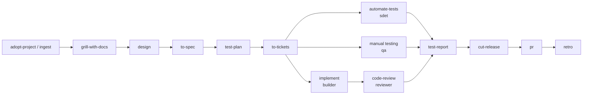

<div align="center">

# 🧰 engr-toolbox

**A ticket-driven engineering workflow for AI coding agents.**
Skills, roles, a project structure, and a CLI (command-line interface) that keeps the agent honest.


```bash
npx --allow-git=all github:work-w-chrstnrpj/engr-toolbox
```

</div>

---

## What it is

engr-toolbox is **four things that work together**:

| | Part | What it gives you | Where it lives |
|---|---|---|---|
| 🧠 | **Skillset** | 40 reusable steps the agent runs: brainstorm, design, spec, tickets, build test-first, review, test, release | `.agents/skills/` |
| 🔁 | **Workflow** | The order of those steps, from idea to release, with a gate before each phase | `.agents/workflows/` |
| 🗂️ | **Structure** | Fixed places for context: glossary, decisions, team documents, designs, maps, tests, tickets | `docs/`, `qa/`, `tickets/`, `.ai/` |
| 👥 | **Roles** | Five owners, one per kind of ticket: architect, builder, reviewer, QA (Quality Assurance), SDET (Software Development Engineer in Test) | `.agents/roles/` |

Plus a **zero-dependency CLI** that checks the rules instead of hoping the agent follows them.

> **The one rule:** no work without a ticket, and every ticket ends with evidence.

## Why: engineering, not vibe coding

| What goes wrong with AI agents | What engr-toolbox does |
|---|---|
| The agent builds the wrong thing | `grill-with-docs` interviews you until every decision is made |
| It invents words and forgets decisions | `GLOSSARY.md` for shared language, ADRs (Architecture Decision Records) for decisions |
| The code doesn't actually work | Test-first at agreed seams, verification commands, two-axis code review |
| Nobody can prove what was done | Tickets with a progress log and evidence; `done` without evidence fails |
| "Done" means "tests are green" | `gate deliver`: every acceptance criterion has a passing test that names it, is ticked, and has evidence; the agent loops until it passes |
| The agent hides or quietly fixes unrelated bugs | Bugs found along the way are filed with `report-bug` and wait for triage; blockers and S1s stop the work |
| The team handed you a TDD (Technical Design Document), an API (Application Programming Interface) spec and a folder of notes | `/ingest` a whole folder into read-only `docs/inputs/`, with versions kept; design-first tickets with ERD (Entity Relationship Diagram) and flows |
| Teammates change code and the docs rot | `drift` finds what changed, `update-docs` fixes facts and flags decisions |
| Quality is judged by feel | Acceptance-criteria IDs, traceability, JUnit reports, flaky tracking |
| Merging and releasing is manual and inconsistent | Optional CI/CD (Continuous Integration and Continuous Delivery): tests on every PR (pull request), release to GitHub, npm or Docker on merge to main |
| Automation runs away | Gates, a required verify command, retry caps, hand-off to a human |

## How it works



Every box is a skill. Every arrow passes through a ticket. Lost at any point? Run **`/next`**.

## Quick start

**1. Install** in your project folder (Node 18+):

```bash
npx --allow-git=all github:work-w-chrstnrpj/engr-toolbox
```

Use the arrow keys to pick: new or existing project, size, **one or more AI tools** (Space to tick), where tickets live, project or global skills, and optional CI/CD.

**2. Onboard** in your AI tool (Claude Code, Codex, Cursor, ...):

| Your situation | Run |
|---|---|
| Existing codebase | `/adopt-project` |
| The team gave you documents | `/ingest <folder or files>` |
| New project | Fill in `AGENTS.md`, then `/grill-with-docs` |

**3. Work** one ticket at a time: `/implement cart/01`. Check progress with `/cli status`.

📖 Full walkthrough: **[docs/guide.md](docs/guide.md)**

## Pick a size

| Size | For | You get |
|---|---|---|
| **small** | Solo or small project | Ticket workflow, test-first build, review, glossary, ADRs, builder and reviewer |
| **medium** | Team project | + team inputs, design-first, QA and SDET layer, triage, release checks, reference docs, context maps |
| **large** | Big codebase or many teams | + parallel builds, wayfinding for foggy efforts, architecture surveys, deployment docs, heavy context tools |

## Roles

| Role | Owns | Access |
|---|---|---|
| 🏛️ **architect** | Design tickets: ERD, flows, API design, ADRs, specs, tickets | read-write |
| 🔨 **builder** | Dev and bug tickets: test-first implementation, docs, evidence | read-write |
| 🔍 **reviewer** | Review tickets: standards, spec, security | **read-only** |
| 🧪 **qa** | Manual, exploratory, UAT (User Acceptance Testing) and regression testing; bug reports | read-write |
| 🤖 **sdet** | Test strategy, automation, CI tests, flaky tests, traceability, go/no-go | read-write |

## Skills at a glance

| Phase | Skills |
|---|---|
| Start | `adopt-project`, `ingest`, `next`, `cli` |
| Think | `grill-with-docs`, `grilling`, `design`, `prototype`, `wayfinder`, `domain-modeling`, `codebase-design` |
| Plan | `to-spec`, `test-strategy`, `test-plan`, `to-tickets`, `triage` |
| Build | `implement`, `implement-spec`, `tdd` (test-driven development), `diagnosing-bugs`, `update-docs` |
| Test | `automate-tests`, `manual-testing`, `report-bug`, `fix-flaky-tests`, `test-report` |
| Ship | `code-review`, `cut-release`, `setup-pipeline`, `pr` (pull request), `retro` (retrospective), `generate-rca` (root cause analysis) |
| Helpers | `mentor`, `coach`, `handoff`, `to-questionnaire`, `ask-repo-question`, `use-context-tools` |

See them all, with descriptions: `/cli discover skills` in your agent, or `engr --help-discover-skillset` in the terminal.

## The structure it installs

```text
your-project/
├── AGENTS.md              ← goal, stack, verification commands, how we work (read first)
├── GLOSSARY.md            ← the project's words
├── docs/
│   ├── architecture.md    ← one-page architecture
│   ├── adr/               ← Architecture Decision Records: decisions and why (never rewritten, only superseded)
│   ├── inputs/            ← documents from your team, read-only
│   ├── design/            ← Entity Relationship Diagrams (ERD), flows, API changes
│   └── api/ database/ testing/ deployment/   ← the system as it is now
├── qa/                    ← quality assurance: test strategy, plans, cases, runs, traceability, flaky list
├── tickets/
│   ├── BOARD.md           ← generated board
│   └── <feature>/         ← spec.md + one file per ticket
├── .ai/
│   ├── maps/              ← where things are in the code
│   └── cli/               ← the workflow CLI, pinned to this project
└── .agents/               ← skills, roles, workflows, policies (or installed globally)
```

## Commands

In Claude Code or Codex you never need to type these. Use `/cli status` or just ask: *"is cart ready to ship?"*

| Command | What it does |
|---|---|
| `engr status` | Ticket board: ready, in progress, blocked, done |
| `engr gate deliver --ticket cart/01` | Is this ticket fully done? Every criterion tested and ticked, evidence recorded |
| `engr gate release --feature cart` | Is it ready to ship? Blocks on open tickets, missing evidence, untested criteria, open S1/S2 bugs |
| `engr trace --feature cart` | Which acceptance criteria have tests or manual cases |
| `engr test-report --junit results/ --write` | Record test results, track flaky tests, update ticket evidence |
| `engr inputs add ~/Downloads/payments-team --to payments` | Bring a folder of team documents in; only new and changed files, old versions kept |
| `engr drift` | What teammates changed since your last sync |
| `engr validate` | Tickets, ADRs, map paths, skills: all consistent? |
| `engr pipeline --mode release --write` | Optional CI/CD: tests on PRs, release on merge to main |
| `engr --help-discover` | Everything installed: skills, roles, workflows, docs, structure |

`engr` is the short command (`npm install -g --allow-git=all github:work-w-chrstnrpj/engr-toolbox`, once). Without it: `node .ai/cli/bin/cli.mjs <command>`.

## CI/CD (optional)

```text
feature ──PR──▶ develop ──PR──▶ main ──▶ release
          tests            tests       tests + release / tag / npm / Docker
```

Easiest: run **`/setup-pipeline`** and answer what each branch should run. The agent writes the GitHub Actions YAML for you, so feature → develop can run only tests while develop → main runs tests, build, tag, release and packages. Or pick defaults during install, or use `engr pipeline`. Branch names, commands and release targets are all configurable; `--dev-branch none` gives a simple feature → main flow. Works with **GitHub Actions** and **GitLab CI** (generated), and any other CI system (`/setup-pipeline` writes it). Releases only happen when the version is new, so a merge without a version bump never publishes. Prepare one with `/cut-release`.

## Works with

Claude Code · Codex · Cursor · GitHub Copilot · OpenCode · Windsurf · Cline · Kilo Code · Aider · Antigravity · OpenHands

One source in `.agents/` generates each tool's own files. Install the skills **in the project** (the whole team gets them, best for teams) or **globally** (once per machine, shared across your projects).

## Docs

| | |
|---|---|
| 📖 [Guide](docs/guide.md) | Step-by-step: from install to release, for every role |
| 🚀 [Getting started](docs/getting-started.md) | Install options, sizes, project vs global |
| 🔁 [Workflow](docs/workflow.md) | Which skill when, gates, where context lives |
| ⌨️ [Commands](docs/commands/commands.md) | Every command and option |
| 🏗️ [Architecture](docs/architecture.md) | How the toolbox is built |
| 🧾 [Decisions](docs/adr/) | Why it works this way |

## Credits

Many workflow skills are adapted from [Matt Pocock's skills](https://github.com/mattpocock/skills) (MIT): grilling, specs, tracer-bullet tickets, test-driven development at seams, two-axis review and more. engr-toolbox adds tickets with evidence, team inputs, design-first work, the QA and SDET layer, enforcement gates, size tiers and multi-tool support. See [THIRD_PARTY_NOTICES.md](THIRD_PARTY_NOTICES.md).

## License

MIT
